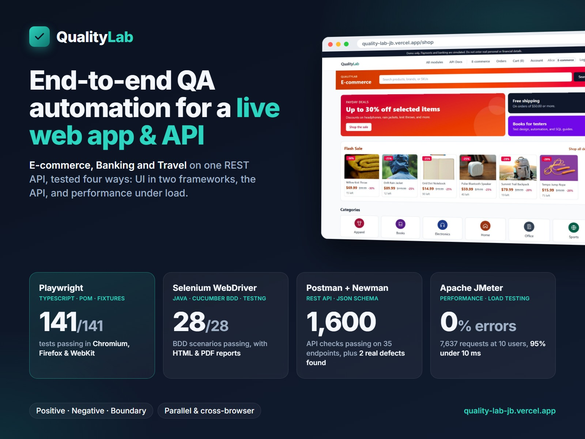

# QualityLab



QualityLab is a personal QA engineering project by Job G. Brioso. It is a demonstration web application built to be the target system for UI, API, and performance test automation.

The application simulates three business domains behind one REST API: e-commerce, banking, and travel with cruise and hotel booking. Each sign-in opens one module, so switching modules means signing in again. It uses fictional data, simulated payments, and no real banking or payment integrations.

> QualityLab is an independent educational and QA automation demonstration project. It is not affiliated with, endorsed by, or associated with any company or brand.

Some screens take general layout ideas and flows from public marketplace, cruise, and Philippine banking sites, such as how a bank app opens an account online. All branding, text, illustrations, products, ships, hotels, and prices are original and fictional. Product, hotel, ship, and destination photos are free Unsplash photos used under the Unsplash License, with no brands shown. Each one is credited in [Image credits](documentation/image-credits.md).

**Live demo:** https://quality-lab-jb.vercel.app ([API docs](https://quality-lab-jb.vercel.app/api-docs), [health check](https://quality-lab-jb.vercel.app/api/v1/health))

## Project status

QualityLab is split into five repositories: this one holds the application and the shared QA documentation, and each test project has its own.

| Phase | Repository | Scope | Status |
| --- | --- | --- | --- |
| 1 | **QualityLab** (this repo) | QA demonstration web application (`web-app/`) and documentation | Deployed to STAGING on Vercel, with a hosted PostgreSQL database |
| 2 | [qualitylab-selenium-java](https://github.com/jjjgbrioso/qualitylab-selenium-java) | Selenium Java + Cucumber BDD UI automation | 28 scenarios passing against the deployed site |
| 3 | [qualitylab-playwright-typescript](https://github.com/jjjgbrioso/qualitylab-playwright-typescript) | Playwright TypeScript UI + API-assisted automation | 141 tests passing in Chromium, Firefox and WebKit against the deployed site |
| 4 | [qualitylab-api-testing](https://github.com/jjjgbrioso/qualitylab-api-testing) | API testing with Postman and Newman | 35 endpoints, 1,602 checks; 2 genuine API defects documented |
| 5 | [qualitylab-jmeter](https://github.com/jjjgbrioso/qualitylab-jmeter) | Performance testing with Apache JMeter | Baseline, load, stress, spike and endurance profiles; all five run with 0% errors: baselines on LOCAL and DEPLOYED, load, stress (50 users), spike and a 1-hour endurance run on LOCAL ([results](https://github.com/jjjgbrioso/qualitylab-jmeter/blob/main/RESULTS.md)) |

### Latest automation results

| Framework | Fully passed run | Run with failures |
| --- | --- | --- |
| Playwright TypeScript | 141 of 141 passed: [PDF](https://github.com/jjjgbrioso/qualitylab-playwright-typescript/blob/main/docs/test-reports/passed/test-report.pdf) | 25 of 33 passed (demonstration with a strict time limit): [PDF](https://github.com/jjjgbrioso/qualitylab-playwright-typescript/blob/main/docs/test-reports/failed/test-report.pdf) |
| Selenium Java + Cucumber | 28 of 28 passed: [PDF](https://github.com/jjjgbrioso/qualitylab-selenium-java/blob/main/docs/test-reports/passed/test-report.pdf) | 6 of 7 passed (the live site timed out): [PDF](https://github.com/jjjgbrioso/qualitylab-selenium-java/blob/main/docs/test-reports/failed/test-report.pdf) |

Details and the HTML versions are in each project's **Sample reports** section.

## Repository structure

```
QualityLab/
├── web-app/          Next.js application, API, database schema, seed data, tests
├── documentation/    Test data, test scenarios, test cases, API and deployment guides
└── README.md
```

The test projects run against the deployed site by default, or against a copy of `web-app` running on your PC. To work on them, clone each repository next to this one.

## What the application includes

- **E-commerce:** a marketplace homepage with promotions, a flash sale, and category tiles; product search, filters, sorting, and pagination; sale prices and discounts; product details with Buy now; shopping cart; inventory; checkout with simulated payment; order history and cancellation; admin product and inventory management
- **Banking (simulated):** accounts and balances, deposits, withdrawals, transfers between test accounts, transaction history, and insufficient balance, invalid account, and duplicate transaction checks
- **Travel & Cruise:** a travel homepage with cruise and hotel search; fictional ships, sailings, itineraries, and cabin types; cabin availability and booking; hotel search, room availability, and booking; guest information; booking history and cancellation, with date and guest validation
- **Account:** a profile page with order, booking, cart, and bank account activity
- **Authentication:** registration, login, logout, hashed passwords, JWT, and CUSTOMER and ADMIN roles on protected pages and endpoints. Each login opens one module (E-commerce, Banking, Travel & Cruise, or Admin), and the pages and API refuse the others
- **Banking:** online account opening, peso accounts, time deposits, and personal loans with full applicant details, address history, interview questions, an optional guarantor, a rule-based credit check, availment, and instalment payments
- **API:** versioned endpoints under `/api/v1/`, input validation, consistent status codes and errors, pagination, and Swagger documentation
- **Automation support:** stable `data-testid` attributes, accessible labels, predictable test accounts, deterministic seed data, seed and reset scripts, and a health-check endpoint

## Technology

Next.js 16, React 19, TypeScript 5.9, Tailwind CSS 4, Next.js Route Handlers on Node.js, PostgreSQL, Prisma 7, Zod, jose (JWT), bcryptjs, Swagger UI with OpenAPI 3.1, and Vitest.

## Get started

Follow [web-app/README.md](web-app/README.md) to install and run the application locally.

## Documentation

- [Test data and accounts](documentation/test-data.md)
- [Test scenarios](documentation/test-scenarios.md)
- [Test cases](documentation/test-cases/README.md): step-by-step cases per module, as Markdown and CSV
- [API guide](documentation/api-guide.md)
- [Automation guide](documentation/automation-guide.md)
- [Environments and deployment](documentation/deployment.md)
- [Image credits](documentation/image-credits.md)
